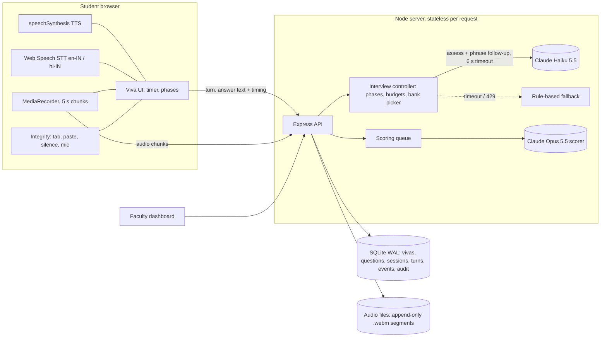

# Design

## Architecture

## Key decisions

**1. The controller decides the structure and the LLM decides the content.** Phase timing, how many questions each phase gets, follow-up limits and which bank question comes next are all deterministic code (`src/interviewer.js`). The LLM is only asked to (a) classify the latest answer as strong, partial, none or off-topic and (b) phrase one short follow-up from the actions the controller allows. This makes every viva structurally identical (fair), means every main question is a bank question whose ID is logged (traceable), and keeps the viva running when the LLM is slow or down: the rule-based fallback takes over and the turn is logged with `mode: fallback`.

**2. The interviewer is separate from the scorer.** The live turn uses Claude Haiku 5.5 at low effort with thinking disabled and a 6 s timeout, because speed matters most there. Scoring runs afterwards on the full transcript from a background queue, using Claude Opus 5.5 at `high` effort, so it never competes with live turns.

**3. Every score cites evidence.** Each transcript line gets an ID (`L12`). The scorer must return line IDs for every dimension and every feedback line, and the server drops any ID that doesn't exist and flags the viva. On the review page each ID is clickable and jumps to that transcript line and audio moment.

**4. Temperature 0.** Claude Opus 5.5 rejects non-default sampling parameters, so this app can't literally set `temperature: 0` on the default scorer. It gets consistent scores in other ways:
- a fixed, versioned prompt (`scorer-v1.0`), whose version and SHA-256 prefix are stored with every result;
- a JSON schema that forces structured output;
- integer 0–5 scores with an anchored scale;
- server-side computation of the weighted total.

`npm run consistency` measures the variance across repeated runs. If MSOT requires a literal temperature of 0, set `SCORER_MODEL=claude-sonnet-4-6`; `src/llm.js` automatically sends `temperature: 0` to models that accept it.

**5. The browser does speech for the MVP.** The Web Speech API costs nothing and adds no server load, and Chrome's `en-IN` and `hi-IN` recognition handles Indian English and Hinglish reasonably well. The trade-offs:
- Chrome sends the audio to Google for recognition (see PRIVACY.md).
- Recognition quality depends on the browser.
- The recording captures the student's mic, not the synthesised examiner voice. The examiner's lines are in the timestamped transcript.

For production, put [faster-whisper](https://github.com/SYSTRAN/faster-whisper) behind the same `/turn` contract (stream the audio chunks to it instead of using browser STT), or use Sarvam or Azure for Indic languages. The rest of the system doesn't need to change.

**6. Robustness.**
- **Network drop:** the client retries with backoff, and every turn carries an idempotency key so a retried turn gets the same reply.
- **Rejoin:** the student uses the same code and ID. The session resumes, the examiner repeats its last line, and a new audio segment starts. The clock keeps running, as it would for a student who left the room.
- **Long silence:** after 20 s with no speech, the turn is submitted empty, logged as a silence, and the viva moves on.
- **Long answers:** an answer is cut off at 90 s and the cut-off is logged.
- **Muted mic:** a level meter detects 15 s of dead input while the app is listening and logs a `mic_muted` event.
- **Browser closed:** a server sweep ends any viva past its slot and queues it for scoring.

**7. Prompt-injection defence.**
- The student's speech is wrapped in `<student_answer>` and the prompt says to treat it as data only.
- A manipulation attempt is classified as off-topic and redirected once.
- The scorer flags `manipulation_attempt`, which triggers mandatory review.
- The examiner prompt forbids revealing answers or discussing marks.

## Viva structure (customisable per viva)

| Phase | Default | Controller behaviour |
|---|---|---|
| Warm-up | 0:00–1:00 | Fixed greeting with ID confirmation and rules, then the project opener (1 follow-up allowed) |
| Fundamentals | 1:00–5:00 | Up to 3 concept questions, one per topic; at most 1 follow-up each; moves on early once 3 are done |
| Depth | 5:00–10:00 | Targets the student's strongest topic (from answer quality scores so far); up to 3 follow-ups per question |
| Applied | 10:00–13:00 | A scenario or debugging question; hints and deeper follow-ups; a second scenario if more than 75 s remain |
| Wrap-up | 13:00–14:30 | "Anything to add?", then the closing line |
| Scoring | 14:30–15:00 | The session ends and is queued for scoring |

Faculty can change the phase durations when they create a viva. The server rejects any set of phases longer than 15 minutes.

## Scaling and capacity plan (150 concurrent students)

**State:** all session state is in the database and every request reads it, so any server instance can handle any turn. To scale horizontally, run N Node instances behind a load balancer, move SQLite to PostgreSQL (the schema carries over unchanged) and move the audio files to S3 or MinIO (multipart upload per segment).

**LLM load at 150 concurrent students:** about 1 turn every 25–40 s per student, so roughly 4–6 interviewer requests per second (around 300 RPM, ~1.2 k input tokens each, about 400 k input tokens per minute). That needs an Anthropic rate-limit tier at or above that level for Haiku 5.5. Scoring is bursty (all sessions end within a minute or two) but asynchronous. With `SCORING_CONCURRENCY=8` and roughly 40–60 s per scoring call, 150 vivas finish scoring in 12–20 minutes.

**Rate-limit handling:**
- **Interviewer:** 2 attempts within the 6 s budget, honouring `retry-after`, then the rule-based fallback, so a turn is never blocked.
- **Scorer:** 3 attempts with exponential backoff inside the queue, then 2 more re-queues. If it still fails, the viva is marked `failed`, flagged for review and can be re-scored with one click.
- **Refusals:** the Opus 5.5 scorer uses server-side fallbacks (`fallbacks: "default"`), so a safety-classifier refusal is retried on another model instead of failing.

**Server:** see the load test in TEST_REPORT.md. A single Node process handled 150 concurrent synthetic students in mock mode. In LLM mode the bottleneck moves to API latency and rate limits, not the server.

## Known limitations / next steps
- Bank size matters. With the 11-question sample bank, a student who answers "I don't know" to everything runs out of questions and reaches the wrap-up early. Use at least 20 approved questions per viva (about 6 concept, 8 depth and 4 applied).
- Faculty authentication is a shared passcode. Production should use the institute's SSO with per-reviewer accounts.
- The code/whiteboard round and multiple-voice detection aren't built yet.
- Latency in LLM mode hasn't been measured yet because no API key was available during the build (see TEST_REPORT.md).
